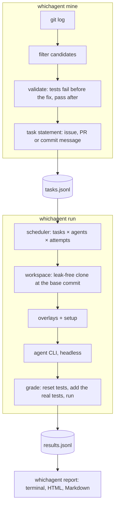

# whichagent architecture

> Design for v0.1–v0.4, all implemented. Section 19 says what has been run against real repos and agents, and what hasn't yet.

## 1. Goal

One command that answers: **which coding agent, with which setup, solves real tasks from my repo, how often, at what cost, and is the difference real?**

Principles:

- **Real tasks only.** Every task is a commit from your history, checked by your own tests. No synthetic bugs.
- **Local.** No service, no account, no upload. Results stay in your repo.
- **Honest numbers.** No answer leaks, no test tampering, an interval on every rate, a significance test on every comparison.
- **Zero dependencies.** Python standard library plus `git`. `gh` and Docker are optional.

Not goals: a hosted leaderboard, building agents, generating training data.

## 2. Pipeline



`mine` and `run` append to JSONL files as they go, so every command can be stopped and resumed without losing work.

## 3. Where things live

| What | Where |
|---|---|
| whichagent's code | this repo, `src/whichagent/` |
| Your config | `whichagent.toml` at your repo root (commit it) |
| Tasks, results, logs, diffs, reports | `.whichagent/` in your repo (add it to `.gitignore`) |
| Leak-free base clones | `.whichagent/bases/<task>.git`, one per task, made during `mine` |
| Workspaces | the system temp dir, one per run, deleted after grading (`--keep` to inspect) |
| Dependency cache | the system temp dir, `whichagent-cache/`: the 3 most recently used dependency sets per repo |
| Model prices | models.dev public JSON, cached for 24 hours in `.whichagent/prices.json` |
| whichagent's own CI | GitHub Actions on Linux, macOS and Windows, with fixture repos and fake agents (no API spend) |
| Releases | PyPI, published from GitHub Actions on version tags (trusted publishing) |

Workspaces sit in the temp dir on purpose: inside a synced folder (OneDrive, Dropbox) every run would trigger a sync of thousands of files.

## 4. Data model

### Task: one line in `.whichagent/tasks.jsonl`

```jsonc
{
  "id": "3f9c2e1",                  // short sha of the fix commit
  "base": "<sha>",                  // parent of the fix: where agents start
  "fix": "<sha>",                   // the real fix
  "date": "2026-09-14",
  "statement": "CSV reader drops the last row when the file has no trailing newline ...",
  "statement_source": "pr",         // issue | pr | commit
  "source_files": ["src/csvkit/reader.py"],
  "test_files": ["tests/test_reader.py"],
  "fix_lines": 14,                  // changed source lines in the real fix
  "mode": "hidden",                 // hidden | visible (see 5.3)
  "suite_green": true,              // full suite passes at the fix commit
  "fail_to_pass": ["tests/test_reader.py::test_no_trailing_newline"],  // per-test grading, section 8
  "pass_to_pass": ["tests/test_reader.py::test_basic"],
  "suite_failing": [],              // tests already failing in the full suite at the fix
  "test_secs": 8.2                  // how long the task's tests take
}
```

### Result: one line in `.whichagent/results.jsonl`

```jsonc
{
  "task": "3f9c2e1", "agent": "codex", "attempt": 1,
  "status": "solved",               // solved | failed | timeout | agent_error | setup_error
  "tests_pass": true,
  "f2p": "1/1", "p2p": "12/12",     // per-test grading: flipped tests passing, kept tests passing
  "regression": false,              // a test that passed at the fix fails now
  "broke": [],                      // which ones
  "cost_usd": 0.31, "tokens_in": 182000, "tokens_out": 9100,
  "secs": 245, "turns": 18,
  "files_changed": 2,
  "extra_files": 0,                 // changed files the real fix didn't touch
  "wrote_tests": true,              // added tests of its own (reported, not graded)
  "tampered": false,                // edited existing tests or test config
  "agent_version": "codex-cli 0.x",
  "model": "..."
}
```

Each run also keeps `prompt.txt`, `install.log`, `setup.log`, `stdout.log`, `stderr.log`, `agent.diff`, `tests.log` and `suite.log` in `.whichagent/runs/<task>/<agent>@<version>/<attempt>/`.

## 5. Mining

### 5.1 Candidate filter (cheap: reads history, runs nothing)

`git log --no-merges --numstat` over the window (`since`, default 12 months) on the current branch. A commit is a candidate when:

- it changes at least one test file and at least one source file (decided by `test_patterns`)
- the source change is small: at most `max_files` (5) files and `max_lines` (200) changed lines
- it doesn't touch dependency files (`skip_if_changed`: lockfiles, `requirements*.txt`, ...). A dependency change means the base commit's environment can't run the new tests.
- it has a usable statement (5.4)

Candidates are sorted newest first and capped at `max_candidates` (300).

### 5.2 Validation (expensive: runs tests; parallel; cached in `tasks.jsonl`)

For each candidate, in a fresh workspace at `base` (section 6):

1. run `setup`
2. copy in the fix commit's versions of the task's test files and run the test command on them: it must **fail**
3. copy in the fix commit's source files and run again: it must **pass**
4. run the full suite once and store `suite_green` (this enables the regression check)
5. repeat steps 2–3 `verify_runs` times (default 2); any disagreement means flaky, and the candidate is dropped

Mining stops when `max_tasks` (25) valid tasks are found.

When the test runner reports per-test results (section 8), steps 2–3 record which tests fail before the fix and pass after (`fail_to_pass`, at least one) and which pass both times (`pass_to_pass`); repeated runs must agree on both lists. Step 4 records the tests that already fail in the full suite (`suite_failing`), so regressions can be checked even when the suite isn't fully green.

### 5.3 Hidden vs visible tests

- **hidden** (default, SWE-bench style): the agent gets the statement only, and the real tests appear at grading time. This is the realistic case: real tasks don't come with tests.
- **visible**: the agent also gets the new failing tests in its workspace, with an instruction not to edit them.

A task switches to visible when the failure in step 2 shows the tests can't even load: per-stack patterns such as `ImportError`, `errors during collection` or `Cannot find module`. That usually means the fix added a new function or module, and without seeing the tests an agent would have to guess its exact name.

### 5.4 Task statements

The first available of:

1. the linked issue (`Fixes #123` in the commit or PR), via `gh`
2. the PR that merged the commit, via `gh api repos/{owner}/{repo}/commits/{sha}/pulls`
3. the commit message, if it has at least `min_statement_words` (8) words

The prompt is identical for every agent:

```text
Resolve the following task in this repository.

<statement>
```

Visible mode appends the list of failing test files and "Don't edit these files."

Commit messages sometimes describe the fix itself ("use <= instead of <"). That inflates absolute scores but helps every agent equally, so comparisons stay fair. `statement_source` is shown in the report so you can filter.

### 5.5 Contamination

Models may have seen public repos in training. `--since <date>` keeps only commits after that date: use the latest training cutoff among the models you compare. Private repos don't have this problem.

## 6. Workspaces

Every validation and every agent run gets a fresh directory in the system temp dir.

**Leak-free base clones.** During mining, each task gets one bare clone that contains only the history up to `base`:

```bash
git -C <repo> branch whichagent/tmp-<id> <base>
git clone --bare --single-branch --no-tags --depth <history_depth> \
    --branch whichagent/tmp-<id> file://<repo> .whichagent/bases/<id>.git
git -C <repo> branch -D whichagent/tmp-<id>
```

The fix commit and everything after it aren't reachable from `base`, so they never enter the clone. Each workspace is then a fast local clone of that bare repo, with the branch renamed to the repo's default branch and the remote removed. Agents get real `git log` history (default depth 200) and nothing from the future.

**Why not `git worktree`?** Worktrees share the main repo's object store: `git log --all` inside one lists every future commit, including the fix. Agents run `git log` all the time.

**Why outside the repo?** Agents read CLAUDE.md and AGENTS.md from parent directories and sometimes explore `..`. A workspace inside your repo would sit next to today's code, which contains the answer.

**Overlays.** Files from the agent's `overlay` map are copied in after cloning. This is how you A/B a CLAUDE.md, AGENTS.md, MCP config or skill.

**Install and setup.** `install` (dependencies) and then `setup` (builds, codegen) run in every workspace (`setup_timeout`, default 10 minutes). A failure is recorded as `setup_error` and isn't counted against the agent. With `cache = true`, everything `install` created is cached in the temp dir, keyed by the content of the lockfiles, and copied into later workspaces instead of installing again; Node stacks turn this on by default. Python virtualenvs aren't relocatable, and uv's own cache already makes `uv sync` fast.

**Docker mode.** With `--sandbox docker`, install, setup, the agent and the tests run in a container (section 14). git operations stay on the host; the container sees only the run's temp dir, mounted at `/wa`.

## 7. Agent adapters

An agent is data, not code:

```toml
[[agent]]
name    = "claude"
cmd     = "claude -p --output-format json --dangerously-skip-permissions"
stdin   = true              # the prompt goes to stdin
parse   = "claude-json"     # how to read cost, tokens and turns from the output
timeout = "30m"
```

- **Prompt delivery.** Through stdin (`stdin = true`) or a file (`{prompt_file}` in `cmd`), never as a command-line argument. That avoids length limits and the quoting bugs of `.cmd` shims on Windows.
- **Variants.** `extends = "claude"` copies an agent. Add `args = "--model claude-opus-5-5"` to test a model, or `overlay = {...}` to test a setup.
- **Parsers.** One small function per output format: `claude-json`, `codex-jsonl`, `gemini-json`, `aider-text`, and `none` (time and pass/fail only).
- **Prices.** Tokens are converted to dollars with models.dev prices, overridable in `[prices]`. Unknown prices show as `—`, never a guess. On subscription plans, costs are still shown at API prices, which keeps agents comparable on efficiency.
- **Versions.** `<binary> --version` is recorded on every result. Reports flag an agent whose runs span several versions; `--by-version` reports each version separately, and `run --new-version` reruns the tasks an agent has only done with another version.
- **Your global config.** By default agents read your usual global setup (`~/.claude`, `~/.codex`, ...): you're measuring your setup. To isolate an agent, point its config-dir variable elsewhere in its `env`.

Built-in adapters. `whichagent doctor` checks each adapter's flags against the installed CLI's `--help`.

| Agent | Command | Prompt | Cost source |
|---|---|---|---|
| Claude Code | `claude -p --output-format json --dangerously-skip-permissions` | stdin | `total_cost_usd` in the output |
| Codex CLI | `codex exec --json --sandbox workspace-write -` (Codex's own sandbox stays on) | stdin | token usage events × prices |
| Gemini CLI | `gemini --output-format json --yolo` with `GEMINI_CLI_TRUST_WORKSPACE=true` (untrusted folders ignore --yolo and ~/.gemini/.env) | stdin | `stats` tokens × prices |
| Aider | `aider --message-file {prompt_file} --yes-always --no-auto-commits --no-gitignore` (plus quiet flags) | file | the "Cost: ... session" line; $0 for local models (ollama, lm_studio, llamafile) |
| Qwen Code | `qwen --output-format json --yolo` | stdin | `stats` tokens × prices |
| OpenCode | `opencode run --auto --format json` | stdin | `cost` on each step_finish event |
| Goose | `goose run --no-session --instructions {prompt_file} --output-format json` with `GOOSE_MODE=auto` | file | metadata tokens × prices ($0 for Ollama) |
| Amp | `amp --execute --dangerously-allow-all` | stdin | none yet |
| GitHub Copilot CLI | `copilot --allow-all-tools --no-ask-user --output-format json` | stdin | none: premium requests only (model and turns are parsed) |
| Cursor CLI | `cursor-agent --print --force --output-format json` | stdin | none yet |

Claude Code, Codex, Copilot, OpenCode and Aider have been run end to end; every other adapter is marked unverified until it has. An agent's `env` values starting with `$` are read from your shell (`env = { GH_TOKEN = "$GH_TOKEN" }`), so credentials outside the allowlist never have to be written into the TOML.

## 8. Grading

After the agent exits or is killed at its timeout:

1. **Capture.** Stage everything (`git add -A`) and save the diff against the tree the agent started from (`base` plus overlays and, in visible mode, the given tests) as `agent.diff`. Commits the agent made are included; ignored files are not.
2. **Measure.** `files_changed`, `extra_files`, `wrote_tests` (added test lines or files) and `tampered` (removed lines from existing test files, deleted them, or touched test config: `conftest.py`, `pytest.ini`, `jest.config.*`, `vitest.config.*`, ...). Adding a test to an existing file isn't tampering. Edits to `pyproject.toml` or `package.json` are flagged for review rather than reset, since they can be legitimate.
3. **Reset.** Every path matching `test_patterns` or test config goes back to its `base` state (new test files are deleted), then the fix commit's test files are copied in.
4. **Test.** Run the test command on the task's test files (`test_timeout`, default 10 minutes). With per-test results, `tests_pass` means every `fail_to_pass` and `pass_to_pass` test passed; without them, that the command exited 0.
5. **Regression.** If the task's tests pass, run the full suite too. A test that passed at the fix and fails now is a regression (`broke` lists them); without per-test results, any failure counts when the suite was green at the fix. (When the task's tests fail, the run has failed anyway.)
6. **Verdict.** `solved = tests_pass and not regression`.

**Per-test results**, as SWE-bench grades: the test command writes a report to `{report}` — JUnit XML (pytest `--junitxml`, Vitest's and `node --test`'s junit reporters, Maven Surefire), Jest's JSON, or `go test -json`. Gradle's fixed report dir is set with `report`, and cargo's own output is read from the log. Test ids are made relative to the workspace, so they match across runs. Without a report, grading falls back to the exit code of the task's test files.

## 9. Scheduler

- **Matrix.** Tasks × agents × attempts, interleaved task by task. Stopping early (budget, Ctrl-C) still leaves every agent with the same tasks done, so partial results stay comparable.
- **Concurrency.** `jobs` worker threads (all heavy work is subprocesses, so threads are enough) and `jobs_per_agent` to respect subscription rate limits.
- **Resume.** Runs already in `results.jsonl` are skipped. A result is written only when its run finishes. `--retry-errors` reruns runs that ended in `agent_error` or `setup_error` (say, after fixing a login); the newest result counts.
- **Timeouts.** The whole process tree is killed: a new session plus `killpg` on POSIX, `taskkill /T /F` on Windows.
- **Environment.** Agents get an allowlist: PATH, home and temp dirs, locale, the OS variables Windows needs, the provider keys (`ANTHROPIC_API_KEY`, `OPENAI_API_KEY`, `GEMINI_API_KEY`, ...) and the agent's own `env`. Nothing else from your shell. In Docker mode a container gets only the credentials and proxy variables, by name, plus the agent's `env`.
- **Budget.** Before starting, whichagent prints the run count and a cost range based on earlier results (or conservative defaults) and asks to continue (`--yes` skips the prompt). During the run, no new run starts once spent money plus the in-flight estimate would pass `max_cost`.

## 10. Statistics

Standard library only (`math`, `random`).

- **Solve rate.** Solved runs ÷ runs, averaged per task. 95% **Wilson interval** when `attempts = 1`, because it stays sane with small samples and near 0% or 100%. With more attempts, a **bootstrap over tasks**, because runs on the same task aren't independent, never narrower than the task-level Wilson interval (on a few tasks that all score 100%, a plain bootstrap would claim 100%–100%).
- **Solved every time.** The share of tasks solved in all `attempts` runs (pass^k): reliability for unattended use.
- **Cost per solved task.** Total cost ÷ solved runs: the number budgets are made of.
- **Paired comparison.** For agents A and B on shared tasks, A wins a task if its solve rate on it is higher. An exact two-sided **sign test** on wins vs losses (ties dropped) gives the verdict: "A is better (p = 0.002)" or "no real difference (p = 0.45)".
- **Small samples.** Under 15 tasks the report says plainly that only large gaps can be detected.

## 11. Reports

- **Terminal**: the leaderboard and the pairwise verdicts.
- **`report.html`**: one self-contained file (inline CSS, JS and SVG, no CDN, works offline, light and dark). It has the leaderboard, a cost-vs-solve-rate chart showing which agents are on the efficient frontier, and a task × agent grid: click a cell to see the agent's diff next to the real fix.
- **`report.md`**: paste into a PR, an issue or a post.
- **`card.svg`**: a small leaderboard to share or put in a README; it follows the viewer's light or dark theme.
- **Baseline**: `--baseline <results.jsonl>` adds each agent's change against an earlier run, with a paired sign test. The GitHub Action uses it for its PR comment.
- **JSONL**: `tasks.jsonl` and `results.jsonl` for your own analysis.

## 12. Configuration

`whichagent.toml` sits at the repo root. `whichagent init` writes it from the detected stack, and CLI flags override any key.

```toml
[repo]
install         = "uv sync"                                   # dependencies; cache = true caches them
setup           = ""                                          # builds, codegen
test            = "uv run pytest -q {files} --junitxml={report}"   # {files} = the task's test files
suite           = "uv run pytest -q --junitxml={report}"      # the whole suite
test_patterns   = ["tests/**", "**/test_*.py", "**/*_test.py"]
skip_if_changed = ["uv.lock", "requirements*.txt"]

[mine]
since       = "2026-01-01"   # or "12 months"
max_tasks   = 25
max_files   = 5
max_lines   = 200
verify_runs = 2

[run]
agents     = ["claude", "codex", "gemini"]   # default: built-ins found on PATH
attempts   = 1
jobs       = 3
timeout    = "30m"
max_cost   = 25.0            # USD, hard stop
regression = true
sandbox    = "host"              # or "docker"

[docker]                      # for --sandbox docker
image  = ""                   # default: built from .devcontainer/devcontainer.json or a Dockerfile
mounts = ["~/.claude:/root/.claude:ro"]

[[agent]]
name    = "claude-opus"
extends = "claude"
args    = "--model claude-opus-5-5"

[[agent]]
name    = "claude + new CLAUDE.md"
extends = "claude"
overlay = { "CLAUDE.md" = "experiments/CLAUDE.v2.md" }

[prices]                      # USD per million tokens, overrides models.dev
"some-model" = { input = 1.25, output = 10.0 }
```

`{dirs}` (each test file's directory as `./dir`, for `go test`) and `{names}` (file names without extension, for `cargo test --test` and JUnit classes) work like `{files}`; `{names:,}` joins with commas instead of spaces.

Stack detection:

| Found | `install` | `test` | Per-test results |
|---|---|---|---|
| `uv.lock`, `poetry.lock` | `uv sync`, `poetry install` | `pytest -q {files}` | `--junitxml={report}` |
| `package-lock.json`, `pnpm-lock.yaml`, `yarn.lock` | `npm ci`, `pnpm install --frozen-lockfile`, `yarn install` (cached) | `vitest run`, `jest` or `node --test`, picked from `package.json` | junit reporter, Jest JSON |
| `go.mod` | `go mod download` | `go test -json {dirs}` | `go test -json` |
| `Cargo.toml` | `cargo fetch` | `cargo test --no-fail-fast --test {names: --test }` | cargo's output |
| `pom.xml` | `mvn test-compile` | `mvn test -Dtest={names:,}` | Surefire XML |
| `build.gradle(.kts)` | | `gradlew test --tests {names: --tests }` | `build/test-results/test` |
| anything else | `init` asks for setup and test commands | | exit code |

## 13. CLI

```text
whichagent                quickstart: init → mine → estimate → run → report
whichagent init           write whichagent.toml from the detected stack
whichagent doctor         check git, the test command at HEAD, and each agent's flags
whichagent mine           find and validate tasks → .whichagent/tasks.jsonl
whichagent run            run the matrix (resumable) → .whichagent/results.jsonl
whichagent report         terminal table, report.html, report.md, card.svg
whichagent compare A B    paired comparison of two agents
whichagent show <task>    statement, real fix, each agent's diff

--retry-errors            rerun runs that ended in agent_error or setup_error
--new-version             rerun tasks an agent has only done with another version of itself
--by-version              report each agent version separately
--baseline PATH           compare against an earlier results.jsonl
--sandbox docker          run install, setup, agents and tests in a container
--keep                    keep workspaces for inspection
```

## 14. Safety model

Benchmarking means running agents unattended with approvals off. On the host they act with your user's permissions.

On the host, whichagent has:

- throwaway clones outside your repo, so your working tree is never touched
- the environment allowlist (section 9), so secrets in your shell aren't passed through
- timeouts with a process-tree kill, and a hard spend cap
- a one-time confirmation on each machine's first run that says all of this plainly

Not covered on the host: files in your home directory are still reachable, and so is the network. An agent could even find your real repo on disk.

**Docker mode** (`--sandbox docker`) closes the filesystem gap: install, setup, agent and grading run in a container from `[docker] image`, the repo's `.devcontainer/devcontainer.json` or a Dockerfile, with only the run's temp dir mounted. The agent CLIs must be in the image. Credentials reach the container by name only; logins stored in files can be mounted read-only with `[docker] mounts`. Containers are killed with `docker kill` at their timeout. The network stays open, since agents need their APIs.

## 15. Tech stack

- **Python ≥ 3.11, zero runtime dependencies.** The standard library covers it: `argparse`, `subprocess`, `tomllib`, `json`, `concurrent.futures`, `tempfile`, `shutil`, `math`, `random`, `html`. A tool that runs agents with your permissions should be small enough to audit, with nothing in its supply chain.
- **No install step.** `uvx whichagent` or `pipx run whichagent`.
- **git** through `subprocess` (no GitPython). **gh** is optional, for issue and PR text.
- **None of** async, a database, a plugin system or a web server: threads, subprocesses, JSONL, one HTML file.
- **Platforms.** Linux, macOS and Windows, all three in CI.

## 16. Code layout

```text
src/whichagent/
  cli.py          commands and the quickstart flow                ~240 lines
  config.py       TOML loading, defaults, agents and extends      ~160
  stacks.py       stack detection                                 ~55
  store.py        .whichagent/ files: tasks, results, run dirs    ~45
  git.py          history, base clones, workspaces, diffs         ~140
  sandbox.py      host and Docker executors, timeouts, env        ~250
  workspace.py    clone, install with cache, setup                ~95
  mine.py         candidates, validation, statements, mode        ~160
  agents.py       output parsers, prices, flag checks             ~170
  run.py          scheduler, budget, resume                       ~155
  grade.py        placeholders, capture, reset, test, verdict     ~80
  testresults.py  JUnit XML, Jest JSON, go test -json, cargo      ~90
  stats.py        Wilson, bootstrap, pass^k, sign test            ~80
  report.py       terminal, Markdown, HTML, SVG card, baseline    ~310
tests/
  repos.py         builds tiny git repos with known fix commits
  fake_agent.py    fake agents (section 17)
  junit_runner.py  unittest with JUnit XML, so fixtures get per-test results
action.yml         the GitHub Action
```

About 2,000 lines. Dependencies point one way: `cli` uses `mine` and `run`, which use `workspace` and `grade`, which use `git`, `sandbox`, `store` and `testresults`. Nothing imports `cli`, and the executors in `sandbox` share one interface, so mining, running and grading don't care whether commands run on the host or in a container.

## 17. Testing whichagent itself

CI spends nothing on APIs. Tests build small git repos with known bug-fix commits and run the full pipeline against **fake agents**: tiny scripts with known behavior.

| Fake agent | Does | Expected result |
|---|---|---|
| `perfect` | applies the real fix | solved |
| `noop` | nothing | failed |
| `tamper` | edits the test so it passes | failed, `tampered` |
| `breaker` | fixes the bug, breaks another test | failed, regression |
| `sleeper` | sleeps past the timeout | timeout, no processes left behind |
| `peeker` | runs `git log --all` and searches for the fix | finds nothing |
| `escaper` | reads a file outside the workspace | blocked in Docker mode (on the host it can) |

`peeker` is the test behind the "no leaks" claim. The fixtures use `tests/junit_runner.py`, a stdlib unittest runner that writes JUnit XML, so per-test grading is tested without pytest. The Docker test runs when a Docker daemon is available.

## 18. Build order for v0.1

1. `tests/repos.py` fixture builder and the fake agents (tests first)
2. `config.py` and `git.py`: base clones and workspaces, with `peeker` passing
3. `mine.py`: candidate filter, validation, statements → `tasks.jsonl`
4. `grade.py`, checked against the fake agents
5. `run.py`: matrix, jobs, timeouts, env allowlist, resume, budget
6. `agents.py`: the Claude Code adapter first, then Codex, Gemini CLI and Aider
7. `stats.py` and the terminal report
8. `report.py`: Markdown and HTML
9. `init` stack detection, `doctor` and the quickstart flow
10. Dogfooding on 3 open-source repos (at least one Python, one TypeScript): fix what breaks, then publish to PyPI

Steps 1–9 are done. Step 10 is under way: 24 tasks mined on pallets/click, tj/commander.js and remeda/remeda, and what broke is fixed; agent runs on them and the PyPI release are next.

## 19. Milestones

All four are built. The "Done when" checks need real agents, platforms and services:

| Version | Scope | Done when | Status |
|---|---|---|---|
| v0.1 "It runs" | everything in section 18 | 20+ valid tasks mined and 3 agents run end to end on 3 real repos, on Linux, macOS and Windows | 24 tasks mined on 3 repos (Windows); Claude Code run end to end on a fixture repo; Aider + local qwen2.5-coder:7b on commander.js's 6 tasks; grading checked against the real fixes on 16 tasks |
| v0.2 "Sharper" | per-test grading; Go, Rust and Java; dependency cache; shareable SVG results card; comparison across agent versions | the same 3 repos graded per test, plus a Go and a Rust repo | the 3 repos' runners checked with `doctor`; parsers tested on sample Go, Rust and Java output |
| v0.3 "Sandboxed" | Docker and devcontainer mode | `peeker` and a filesystem-escape fake agent are both contained | test written; it needs a Docker daemon |
| v0.4 "Always on" | GitHub Action: reruns on CLAUDE.md or AGENTS.md changes and on a schedule, with a PR comment showing the delta | the action runs on whichagent's own repo | needs GitHub Actions running on the repo |

Later, if people want it: opt-in pooled results across repos ("which agent wins on Django apps?"), rewriting statements to strip solution hints, and tasks that span several commits.

## 20. Known limits and open questions

- **Inline tests** (Rust `#[cfg(test)]`, doctests): tests and code share a file, so a fix can't be split into tests and source by file. v0.1 skips these commits.
- **Monorepos**: one test command may not fit every package. A possible answer is per-path `[repo]` sections; still open.
- **Slow suites**: validation runs tests at least four times per candidate. `max_candidates`, `since` and caching keep this bounded, but a 20-minute suite makes mining slow.
- **Vague statements**: short commit messages make poor tasks. They're filtered by length, and PR or issue text is preferred.
- **Host mode isn't a sandbox**: see section 14.
- **Agent CLIs change often**: adapters are data, versions are recorded, and `doctor` checks the flags.
- **Cost**: a session costs cents to a few dollars, so a full run can reach tens of dollars. The estimate and `max_cost` make that explicit before anything is spent.
