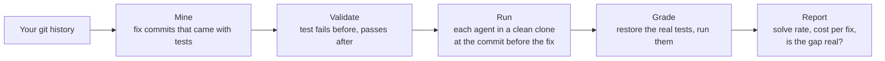

# whichagent

**Find out which coding agent actually works on *your* repo.**

[](LICENSE)
[](#roadmap)

whichagent turns your git history into a benchmark. It finds past commits where a fix landed together with a test, rewinds your repo to just before each fix, and gives the same task to Claude Code, Codex, Gemini CLI, Aider or any agent you add. Your own tests decide who solved it.

> **Pre-release.** The design is done ([ARCHITECTURE.md](ARCHITECTURE.md)) and v0.1 is being built. Star or watch the repo to hear when it ships.

```text
$ uvx whichagent --max-tasks 40
# illustrative output: v0.1 isn't released yet, these are not real results

Mined 412 commits → 40 tasks (test fails before the fix, passes after)
Agents found: claude, codex, gemini
120 runs, estimated $25–$60. Continue? [y/N] y

agent    solved   95% CI    $/run   $/solved   median time
claude   30/40    60–86%    $0.41   $0.55      3m 12s
codex    27/40    52–80%    $0.28   $0.41      4m 05s
gemini   18/40    31–60%    $0.12   $0.27      2m 48s

claude vs codex    5 wins, 2 losses    no real difference (p = 0.45)
claude vs gemini   13 wins, 1 loss     claude is better (p = 0.002)

Report: .whichagent/report.html
```

That's the answer you get: who is actually better on your code, who is just cheaper, and which gaps are noise.

## Why

- **Public benchmarks aren't your code.** SWE-bench and friends measure a fixed set of public repos that every vendor reports on and optimizes for.
- **A new "best model" ships every month.** Switching on hype costs money, and you can't tell whether it helped.
- **Your agent setup is untested.** You edit CLAUDE.md or AGENTS.md, add an MCP server or a skill, and *feel* the agent got better.

whichagent answers with numbers from your code and your tests.

## How it works



1. **Mine.** Scan your history for commits that change code and tests together. Skip merges, big refactors and dependency bumps.
2. **Validate.** Keep a commit only if its tests fail on the code before the fix and pass after it, twice in a row. Now the test is proof of the fix.
3. **Run.** Each agent gets a fresh clone that ends at the commit before the fix, plus a task description from the linked issue, the PR or the commit message. The clone has no future history, so `git log --all` can't leak the answer, and the agent doesn't see the tests.
4. **Grade.** Undo anything the agent did to tests, add the real tests from the fix, run them. Pass means solved.
5. **Report.** Solve rate with confidence intervals, cost per solved task, time, and a paired significance test for every pair of agents.

Everything runs on your machine. Your code goes only to the agents you choose to run, the same as when you use them day to day.

## Measure your setup, not just the agent

Run one agent with two setups and let your tests decide:

```toml
[[agent]]
name    = "claude + new CLAUDE.md"
extends = "claude"
overlay = { "CLAUDE.md" = "experiments/CLAUDE.v2.md" }
```

Overlay files are copied into every workspace before the agent starts. It works for CLAUDE.md, AGENTS.md, MCP configs, skills, rules files, anything.

## Built to be honest

| Trap | What whichagent does |
|---|---|
| Agent finds the fix in future commits | Every run gets a fresh clone that ends at the base commit |
| Agent edits tests until they pass | Tests and test config are reset before grading; tampering is flagged |
| 30/40 vs 27/40 looks like a win | 95% intervals and a paired sign test on every comparison |
| Model trained on your public repo | `--since` uses only commits newer than the models' training cutoff |
| One lucky run | `--attempts 3` reports "solved" and "solved every time" |
| Flaky tests | Tasks are validated twice; flaky ones are dropped |

## Agents

Built-in adapters planned for v0.1:

| Agent | Run as | Cost |
|---|---|---|
| Claude Code | `claude -p --output-format json` | reported by the CLI |
| Codex CLI | `codex exec --json` | tokens × models.dev prices |
| Gemini CLI | `gemini --output-format json` | tokens × models.dev prices |
| Aider | `aider --message-file … --yes-always` | parsed from its output |
| Anything else | any command; the prompt arrives on stdin or as a file | optional |

An adapter is about five lines of TOML, so adding your favorite agent makes a good first PR.

### Run it for $0

whichagent itself is free and local. To benchmark without paying anyone, use open-source agents with local models, or free tiers:

```toml
# Aider + a local Ollama model: no account, no API bill (untested starting point)
[[agent]]
name    = "aider + qwen2.5-coder"
extends = "aider"
args    = "--model ollama_chat/qwen2.5-coder:7b"
env     = { OLLAMA_API_BASE = "http://127.0.0.1:11434" }
```

Gemini CLI also has a free tier when you sign in with a Google account (rate-limited; use a small `--max-tasks`). Local runs report no cost; `[run] max_cost` only matters for paid agents.

## Safety

To benchmark agents you have to run them unattended, with permission prompts off. whichagent:

- runs each agent in a throwaway clone outside your repo, so your working tree is never touched
- passes only the environment variables an agent needs, not your whole shell
- kills runs at the timeout and stops starting new ones at `--max-cost`

This isn't a sandbox: an agent can still reach whatever your user account can. Docker and devcontainer isolation is planned for v0.3.

## FAQ

**How is this different from SWE-bench?** SWE-bench is a fixed research dataset of public Python repos. whichagent builds a benchmark from *your* repo, in any language with a test command.

**And from Harbor?** Harbor is a general framework for running agent benchmarks; you bring the tasks. whichagent finds and validates the tasks in your history for you.

**What does it cost?** Each run is one normal agent session. whichagent shows an estimate before it starts and stops at `--max-cost`. On subscription plans, costs are shown at API prices so agents can still be compared on efficiency.

**Will it work on my repo?** If your tests run from one command and your history has commits that change code and tests together, yes. v0.1 supports Python (pytest) and JS/TS (Vitest, Jest); Go, Rust and Java come next.

**Can it run in CI?** Planned for v0.4: a GitHub Action that reruns when CLAUDE.md or AGENTS.md changes and comments the difference on the PR.

## Roadmap

- **v0.1**: mine, validate, run, grade, report. Python and JS/TS. Claude Code, Codex, Gemini CLI, Aider and custom agents. Setup overlays, spend cap, resumable runs.
- **v0.2**: per-test grading (JUnit XML), Go, Rust and Java, dependency cache, shareable results card.
- **v0.3**: Docker and devcontainer isolation.
- **v0.4**: GitHub Action and scheduled reruns on new model releases.

Full design: [ARCHITECTURE.md](ARCHITECTURE.md).

## Contributing

Issues and ideas are welcome now; code PRs once v0.1 lands. Agent adapters are the easiest place to start.

## License

[MIT](LICENSE)
