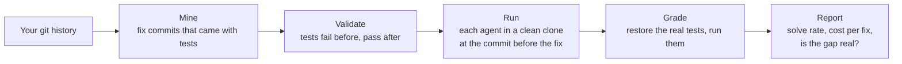

# whichagent

**Find out which coding agent actually works on *your* repo.**

[](LICENSE)
[](#status)
[](pyproject.toml)

whichagent turns your git history into a benchmark. It finds past commits where a fix landed together with a test, rewinds your repo to just before each fix, and gives the same task to Claude Code, Codex, Gemini CLI, Aider or any agent you add. Your own tests decide who solved it.

```text
$ whichagent --max-tasks 40
# illustrative output: not real results

Mined 412 commits -> 40 tasks (tests fail before the fix, pass after)
Agents: claude, codex, gemini
120 runs, estimated $25.00-$60.00. Continue? [y/N] y

agent    solved  95% CI   $/run  $/solved  median time  issues
claude   30/40   60-86%   $0.41  $0.55     3m 12s       -
codex    27/40   52-80%   $0.28  $0.41     4m 05s       1 timeout
gemini   18/40   31-60%   $0.12  $0.27     2m 48s       -

claude vs codex   5 wins, 2 losses   no real difference (p = 0.45)
claude vs gemini  13 wins, 1 loss    claude is better (p = 0.0018)

Report: .whichagent/report.html (also report.md and card.svg)
```

That's the answer you get: who is actually better on your code, who is just cheaper, and which gaps are noise.

## Why

- **Public benchmarks aren't your code.** SWE-bench and friends measure a fixed set of public repos that every vendor reports on and optimizes for.
- **A new "best model" ships every month.** Switching on hype costs money, and you can't tell whether it helped.
- **Your agent setup is untested.** You edit CLAUDE.md or AGENTS.md, add an MCP server or a skill, and *feel* the agent got better.

whichagent answers with numbers from your code and your tests.

## How it works



1. **Mine.** Scan your history for commits that change code and tests together. Skip merges, big refactors and dependency bumps.
2. **Validate.** Keep a commit only if its tests fail on the code before the fix and pass after it, twice in a row. Record exactly which tests flip (fail-to-pass) and which must keep passing.
3. **Run.** Each agent gets a fresh clone that ends at the commit before the fix, plus a task description from the linked issue, the PR or the commit message. The clone has no future history, so `git log --all` can't leak the answer, and the agent doesn't see the tests.
4. **Grade.** Undo anything the agent did to tests, add the real tests from the fix, run them. Solved means the flipped tests pass, the others still pass, and nothing else in the suite broke.
5. **Report.** Solve rate with confidence intervals, cost per solved task, time, and a paired significance test for every pair of agents.

Everything runs on your machine. Your code goes only to the agents you choose to run, the same as when you use them day to day.

## Quickstart

Python 3.11+ and git. Nothing else to install: whichagent has no dependencies.

```bash
pipx install git+https://github.com/itzzdev09/whichagent
```

```bash
cd your-repo
whichagent
```

The first run detects your stack, writes `whichagent.toml`, mines tasks, shows the estimated cost, asks before spending anything, runs every agent it finds and writes the report. Every step resumes where it stopped.

| Command | Does |
|---|---|
| `whichagent` | quickstart: init, mine, estimate, run, report |
| `whichagent init` | write `whichagent.toml` from the detected stack |
| `whichagent doctor` | check git, the test suite at HEAD and each agent's flags |
| `whichagent mine` | find and validate tasks |
| `whichagent run` | run the matrix (resumable) |
| `whichagent report` | leaderboard, best at / best for, how each agent works: terminal, `report.html`, `report.md`, `card.svg` |
| `whichagent compare A B` | paired comparison of two agents |
| `whichagent show <task>` | statement, real fix, each agent's diff |

Every config key is also a flag: `--max-tasks 40`, `--agents claude,gemini`, `--attempts 3`, `--max-cost 10`, `--since 2026-06-01`. `report --merge ../api,../web` combines several repos into one report, and `--agents` narrows it to the agents you name.

### Which agent for which job

The report doesn't stop at one leaderboard. **Best at** names the leader on each axis: most tasks solved, cheapest per fix, fastest fix, fewest tokens per fix, and the agent that stays closest to the files the real fix touched. **Best for** groups the tasks by their real fix (small or large, one file or several, bug fix or feature, language) and says who solved the most in each group, and whether that lead is real or within noise. **How each agent works** lists each agent's median turns, tokens and time to a fix, how often it touched files the real fix didn't, and how often it wrote tests of its own.

`python scripts/share.py OUT REPO...` renders the results as PNGs sized for X, Reddit, LinkedIn and a dev.to cover, in dark and light, with headless Chrome or Edge.

## Measure your setup, not just the agent

Run one agent with two setups and let your tests decide:

```toml
[[agent]]
name    = "claude + new CLAUDE.md"
extends = "claude"
overlay = { "CLAUDE.md" = "experiments/CLAUDE.v2.md" }

[[agent]]
name    = "claude-haiku"          # cheap tiers are worth measuring too
extends = "claude"
args    = "--model haiku"
```

Overlay files are copied into every workspace before the agent starts: CLAUDE.md, AGENTS.md, MCP configs, skills, rules files, anything.

## Built to be honest

| Trap | What whichagent does |
|---|---|
| Agent finds the fix in future commits | Every run gets a fresh clone that ends at the base commit |
| Agent edits tests until they pass | Tests and test config are reset before grading; tampering is flagged |
| Agent breaks something else | Tests that passed at the fix and fail now count as a regression |
| 30/40 vs 27/40 looks like a win | 95% intervals and a paired sign test on every comparison |
| Model trained on your public repo | `--since` uses only commits newer than the models' training cutoff |
| One lucky run | `--attempts 3` reports "solved" and "solved every time" |
| Flaky tests | Tasks are validated twice; flaky ones are dropped |
| Agent auto-updated mid-benchmark | Versions are recorded; mixed versions are flagged, `--by-version` splits them |

## Agents

An adapter is a few lines of TOML, so adding your favorite agent makes a good first PR.

| Agent | Built-in command | Cost data | Status |
|---|---|---|---|
| Claude Code | `claude -p --output-format json` | reported by the CLI | verified |
| Codex CLI | `codex exec --json --sandbox workspace-write -` | tokens x models.dev prices | verified |
| Gemini CLI | `gemini --output-format json --yolo` | tokens x models.dev prices | unverified |
| Qwen Code | `qwen --output-format json --yolo` | tokens x models.dev prices | unverified |
| Aider | `aider --message-file ... --yes-always` | parsed from its output; $0 for local models | verified |
| OpenCode | `opencode run --auto --format json` | reported by the CLI | verified |
| GitHub Copilot CLI | `copilot --allow-all-tools --no-ask-user --output-format json` | none: it reports premium requests, not tokens | verified |
| Goose | `goose run --no-session --instructions ... --output-format json` | tokens x prices; $0 on Ollama | unverified |
| Amp, Cursor CLI | headless mode, prompt on stdin | time and pass/fail only | unverified |
| Anything else | any command; the prompt arrives on stdin or as `{prompt_file}` | optional | |

Unverified adapters follow each CLI's docs but haven't been run by whichagent yet; `whichagent doctor` checks their flags on your machine. Several of these agents have free tiers or free models, which makes them cheap to compare. Agents get only an allowlist of environment variables; pass anything else with `env = { TOKEN = "$MY_TOKEN" }`, which reads it from your shell.

### Run it for $0

whichagent itself is free and local. To benchmark without paying anyone, use open-source agents with local models, or free tiers:

```toml
# Aider + a local Ollama model: no account, no API bill
[[agent]]
name    = "aider-qwen7b"
extends = "aider"
args    = "--model ollama_chat/qwen2.5-coder:7b --no-show-model-warnings"
env     = { OLLAMA_API_BASE = "http://127.0.0.1:11434" }

# OpenCode with one of its free models (`opencode models | grep free`): no account
[[agent]]
name    = "opencode-free"
extends = "opencode"
args    = "-m opencode/deepseek-v4.1-flash-free"

# Qwen Code against Ollama's OpenAI-compatible endpoint
[[agent]]
name    = "qwen-local"
extends = "qwen"
args    = "--auth-type openai"
env     = { OPENAI_BASE_URL = "http://127.0.0.1:11434/v1", OPENAI_API_KEY = "ollama", OPENAI_MODEL = "qwen2.5-coder:7b" }

[prices]
"qwen2.5-coder:7b" = { input = 0, output = 0 }   # so the report shows $0 instead of "no cost"
```

Aider and OpenCode setups above have been run end to end. Small local models are weak agents: on commander.js, qwen2.5-coder:7b solved nothing through Aider and made no tool calls through Qwen Code, while OpenCode's free model solved 1 of 2 tasks. GitHub Copilot's free plan works once you sign in (runs use premium requests from its monthly allowance). Gemini CLI's Google sign-in no longer serves individuals, so it needs a `GEMINI_API_KEY` from Google AI Studio, which has a free tier. Free tiers are rate-limited, so try a few tasks first with `whichagent run --tasks ID1,ID2`. Model names starting with `ollama/`, `ollama_chat/`, `lm_studio/` or `llamafile/` are priced at $0 automatically; `[run] max_cost` only matters for paid agents.

## Stacks

`whichagent init` detects the stack and sets up per-test results where the runner can produce them:

| Found | Install | Tests | Per-test results |
|---|---|---|---|
| `uv.lock`, `poetry.lock` | `uv sync`, `poetry install` | pytest | JUnit XML |
| `package-lock.json`, `pnpm-lock.yaml`, `yarn.lock` | `npm ci`, `pnpm install`, `yarn install` (cached) | Vitest, Jest, `node --test` | JUnit XML, Jest JSON |
| `go.mod` | `go mod download` | `go test` | `go test -json` |
| `Cargo.toml` | `cargo fetch` | `cargo test` (integration tests) | cargo's output |
| `pom.xml`, `build.gradle` | Maven, Gradle | JUnit | Surefire and Gradle XML |

Anything else: `init` asks for your test command, with `{files}` where the test files go. Without per-test results, tasks are graded by the exit code of their test files.

## Sandbox

By default agents run on your machine, in throwaway clones in the temp dir, with an environment allowlist, timeouts that kill the whole process tree, and a hard spend cap. That isn't a sandbox: an agent can still reach whatever your user account can.

`--sandbox docker` runs setup, agents and tests in a container built from your `.devcontainer/devcontainer.json`, a `Dockerfile`, or `[docker] image`, with only the run's temp dir mounted. The agent CLIs must be installed in the image; credentials go in by name, or through `[docker] mounts`.

## In CI

whichagent is also a GitHub Action. This workflow reruns the benchmark when CLAUDE.md or AGENTS.md changes, comments the result on the pull request, and compares it with the last run on the default branch:

```yaml
name: agents
on:
  pull_request:
    paths: [CLAUDE.md, AGENTS.md, ".claude/**"]
  schedule: [{ cron: "0 6 * * 1" }]
  workflow_dispatch:

jobs:
  whichagent:
    runs-on: ubuntu-latest
    permissions: { contents: read, pull-requests: write }
    steps:
      - uses: actions/checkout@v4
        with: { fetch-depth: 0 }   # mining needs the history
      - run: npm install -g @anthropic-ai/claude-code
      - uses: actions/cache/restore@v4
        if: github.event_name == 'pull_request'
        with: { path: baseline, key: whichagent-${{ github.run_id }}, restore-keys: whichagent- }
      - uses: itzzdev09/whichagent@main
        with:
          agents: claude
          baseline: baseline/results.jsonl
        env:
          ANTHROPIC_API_KEY: ${{ secrets.ANTHROPIC_API_KEY }}
      - if: github.event_name != 'pull_request'
        run: mkdir -p baseline && cp .whichagent/results.jsonl baseline/
      - uses: actions/cache/save@v4
        if: github.event_name != 'pull_request'
        with: { path: baseline, key: whichagent-${{ github.run_id }} }
```

So that agents see the pull request's CLAUDE.md rather than the one in each old commit, add `overlay = { "CLAUDE.md" = "CLAUDE.md" }` to the agent in `whichagent.toml`.

## FAQ

**How is this different from SWE-bench?** SWE-bench is a fixed research dataset of public Python repos. whichagent builds a benchmark from *your* repo, in any language with a test command, and grades it the same way: tests that must flip, tests that must keep passing.

**And from Harbor?** Harbor is a general framework for running agent benchmarks; you bring the tasks. whichagent finds and validates the tasks in your history for you.

**What does it cost?** Each run is one normal agent session. whichagent shows an estimate before it starts and stops at `--max-cost`. On subscription plans, costs are shown at API prices so agents can still be compared on efficiency.

**Will it work on my repo?** If your tests run from one command and your history has commits that change code and tests together, yes.

## Status

Pre-release. Everything in [ARCHITECTURE.md](ARCHITECTURE.md) is built and covered by an offline test suite with fake agents; dogfooding on real repos is under way. Grading has been checked against real fixes: on 16 tasks mined from click and commander.js, the real fix is graded solved and no change is graded failed, every time. The Claude Code, Codex, Copilot, OpenCode and Aider adapters have been run end to end (OpenCode with a free model and Aider with a local Ollama model, both at $0); the other adapters, Docker mode and the GitHub Action haven't yet. Star or watch the repo to hear when it lands on PyPI.

## Contributing

Issues and PRs are welcome. Agent adapters are the easiest place to start. Run the tests with `python -m unittest`; they need no API keys.

## License

[MIT](LICENSE)
