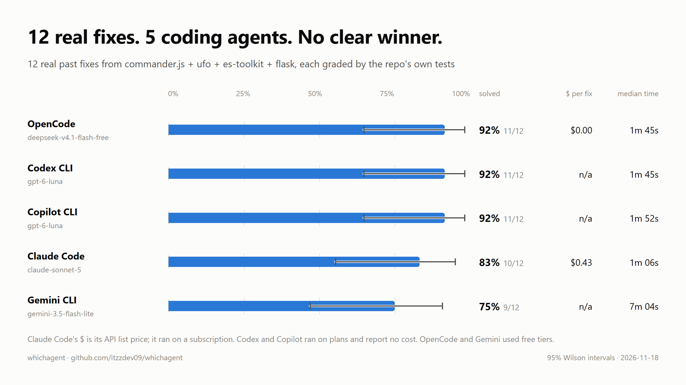
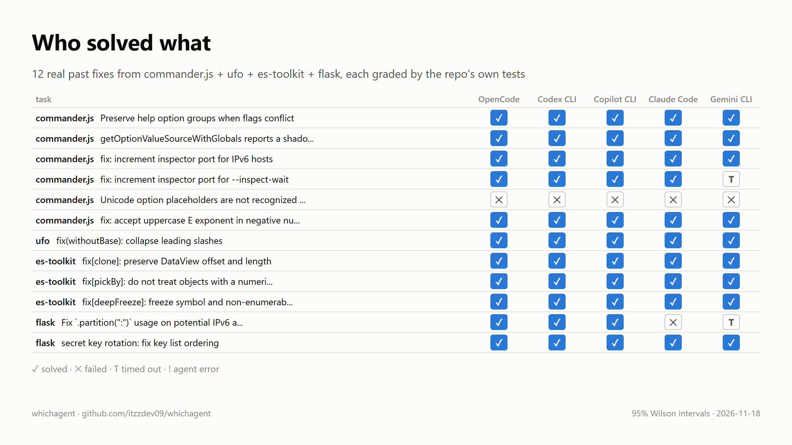
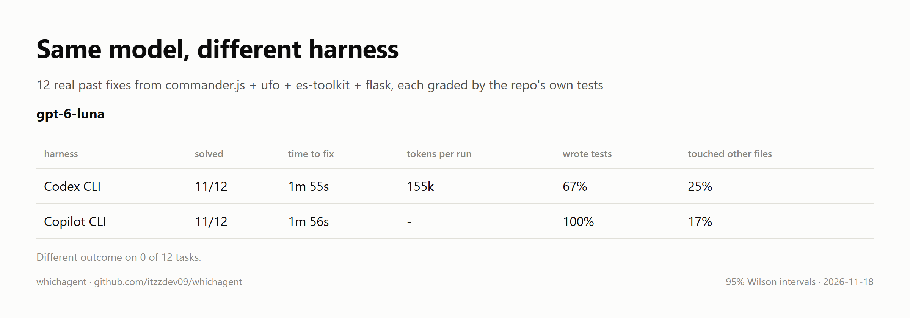
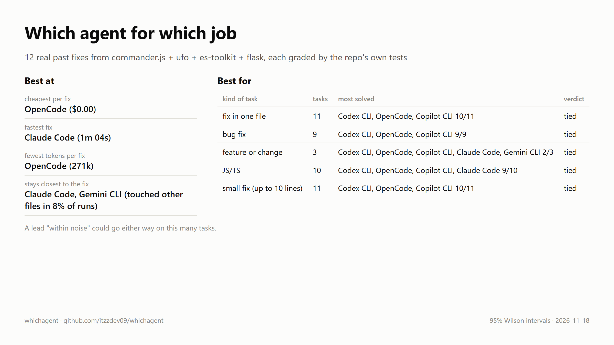
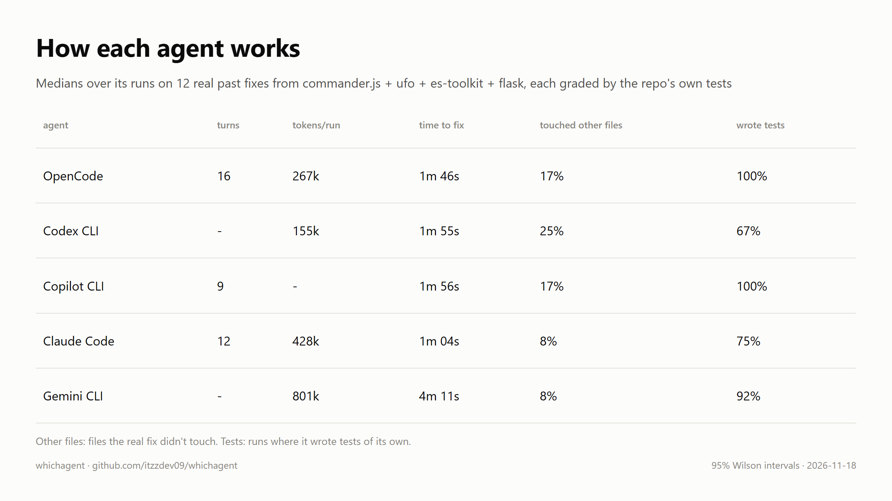

# 12 real fixes, 5 coding agents, no clear winner

I gave five coding agents the same 12 bug reports and feature requests from four open-source repositories. Each one was a change the project had already made, so its real tests could decide whether the agent got it right.

<picture>
  <source media="(prefers-color-scheme: dark)" srcset="images/leaderboard.png">
  
</picture>

## The short version

- **No agent is clearly better.** OpenCode, Codex and Copilot solved 11 of 12, Claude Code 10, Gemini CLI 9. With 12 tasks, no pair differs by more than noise.
- **The same model gave the same result in two different tools.** Codex and Copilot both ran `gpt-6-luna` and solved exactly the same 11 tasks. They worked differently, but the outcomes matched.
- **A free model tied the leaders.** OpenCode's free `deepseek-v4.1-flash-free` solved 11 of 12 at $0.
- **The habits differ more than the scores.** Copilot and OpenCode wrote tests in every run, Codex in 67%. Claude Code was the fastest to a fix and the least likely to touch other files, along with Gemini.
- **Repo instructions change behavior.** One repo's `AGENTS.md` tells agents to stop unless a human owns the change. Codex obeyed it. Copilot and OpenCode kept going.

## Results

| Agent | Model it reported | Solved | 95% interval | Median time | Access used |
|---|---|---|---|---|---|
| OpenCode 1.19.5 | `deepseek-v4.1-flash-free` | **11/12** | 65-99% | 1m 45s | free model, no account |
| Codex CLI 0.169.0 | `gpt-6-luna` | **11/12** | 65-99% | 1m 45s | ChatGPT sign-in |
| Copilot CLI 1.0.112 and 1.0.114 | `gpt-6-luna` | **11/12** | 65-99% | 1m 52s | Copilot sign-in |
| Claude Code 2.1.224 | `claude-sonnet-5` | 10/12 | 55-95% | 1m 06s | Claude subscription |
| Gemini CLI 0.68.0 | `gemini-3.5-flash-lite` | 9/12 | 47-91% | 7m 04s | free AI Studio key |

A paired sign test found no difference between any two agents at p < 0.05. A one-task gap on 12 tasks tells you very little.

## Who solved what

<picture>
  <source media="(prefers-color-scheme: dark)" srcset="images/grid.png">
  
</picture>

Nine of the 12 tasks were solved by all five agents. The other three are where the agents separated:

| Task | What happened |
|---|---|
| commander.js: Unicode option placeholders | All five failed the hidden test (details below) |
| commander.js: `--inspect-wait` port | Gemini's patch passed, but it was still running at the 15-minute limit, so it counts as a timeout |
| flask: IPv6 host parsing | Claude Code's patch broke another test; Gemini timed out |

## Same model, different harness

<picture>
  <source media="(prefers-color-scheme: dark)" srcset="images/harness.png">
  
</picture>

Codex and Copilot are different tools with different prompts, sandboxes and workflows. On these tasks they ran the same model and had the same outcome on all 12. They took about the same time to reach a fix: 1m 55s and 1m 56s.

The difference showed up in how they worked. Copilot wrote tests in every run and Codex in 67%. Codex touched files outside the real fix in 25% of runs and Copilot in 17%.

This is one model on 12 small fixes. Harder tasks could separate them.

## Which agent for which job

<picture>
  <source media="(prefers-color-scheme: dark)" srcset="images/best.png">
  
</picture>

Every category came out tied at the top, so I won't name a best agent for bug fixes or features. These are the practical differences I would use:

| If you care most about | Look at | Evidence here |
|---|---|---|
| Paying nothing | OpenCode's free model | 11/12 at $0, but its free limit stopped a longer run the day before |
| Speed | Claude Code | 1m 04s median time to a fix, the fastest here |
| Staying inside the change | Claude Code or Gemini CLI | Each touched other files in 8% of runs |
| Getting tests with the fix | Copilot or OpenCode | Wrote tests in 100% of runs |
| Low token use | OpenCode or Codex | OpenCode used the fewest per fix (271k); Codex had the lowest median run (155k). Copilot doesn't report tokens |

Gemini's free `flash-lite` route was the slowest here, with a 4m 11s median time to a fix and two timeouts.

## How each agent works

<picture>
  <source media="(prefers-color-scheme: dark)" srcset="images/habits.png">
  
</picture>

A dash means the CLI doesn't report that number. "Touched other files" counts runs that changed a file the real fix didn't change. Some of those are reasonable, such as a changelog or a new test helper.

Four runs changed existing tests or test config: Copilot twice, Codex once and Gemini once. That can't help an agent here, because the real tests are restored before grading.

## Two failures worth reading

### The task nobody solved

The commander.js issue says option placeholders such as `<值...>` aren't recognized as variadic, because the check is ASCII-only. All five agents fixed that case in nearly the same way:

```diff
- this.variadic = /\w\.\.\.[>\]]$/.test(flags);
+ this.variadic = /[\p{L}\p{N}_]\.\.\.[>\]]$/u.test(flags);  // Codex, Copilot, Gemini
+ this.variadic = /[\p{L}\p{N}]\.\.\.[>\]]$/u.test(flags);    // Claude Code, OpenCode
```

The real fix used a broader character class:

```diff
+ this.variadic = /\p{ID_Continue}\.\.\.[>\]]$/u.test(flags);
```

The project's test uses `café`, an `e` followed by a combining accent. A combining mark is neither a letter nor a number, so all five patches miss it. The agents solved the example in the issue and failed a harder case the issue didn't mention. This is a limit of grading with hidden tests as much as a limit of the agents.

### One extra change broke port 0

The flask fix needed one changed line. Claude Code fixed that line, then also rewrote how `SERVER_NAME` is parsed:

```python
sn_url = urlsplit(f"http://{server_name}")
sn_host = sn_url.hostname
sn_port = str(sn_url.port) if sn_url.port else None
```

Port `0` is falsy in Python, so `localhost:0` lost its port. The target test passed, but an existing test failed on both suite runs:

```text
test_run_from_config[None-None-localhost:0-localhost-0]
assert 5000 == 0
```

This is why the benchmark runs the wider test suite after the target tests pass.

## When a repo tells agents to stop

I also tried [remeda](https://github.com/remeda/remeda). Its `AGENTS.md` says each PR needs a human with a personal stake, and that an agent should "surface this policy and stop before producing the change" when that isn't confirmed.

| Agent | remeda tasks with no file changes |
|---|---|
| Codex | 7 of 8 |
| Copilot | 1 of 8 |
| OpenCode | 1 of 8 |

Codex asked whether I personally needed the change and stopped. In a headless run, nobody answers. I left remeda out of the leaderboard for two reasons: the instruction changes what is being measured, and two of my runs overlapped by mistake. Treat this as an observation, not a score. Claude Code hit its plan limit during those runs, so I don't report it here.

## What $0 really got me

| Route | Result |
|---|---|
| OpenCode free model | Worked with no account. On a longer run it hit "Free usage limit reached", and the CLI then hung instead of exiting |
| Gemini CLI with a free AI Studio key | Worked with flash-lite. `gemini-3-flash-preview` used up its daily quota during one task |
| Gemini CLI with Google sign-in | Refused for individual use: the client is no longer supported |
| Groq free tier through OpenCode | Limit is 8,000 tokens per minute; one OpenCode request needed about 8,800 |
| Ollama Cloud free plan | Refused every model I tried, asking for credits or a subscription |
| Local `qwen3:8b` on a 6 GB laptop GPU | One-task test only. Aider and Qwen Code hit the 10-minute limit. Goose read the code and explained a fix but changed no files |

The local result comes from this laptop: RTX 3060 with 6 GB, 16 GB of RAM, and a 16k context. Bigger hardware or a different model could do much better.

## How I ran it

1. **Tasks.** I took past commits that changed source and tests together. The prompt was the linked issue (2 tasks), pull request (9) or commit message (1). Every fix was 2 to 21 lines.
2. **Hidden tests.** The agent got the repo as it was before the fix, without future git history and without the new tests.
3. **Grading.** All 40 target tests had to pass, and the 410 related tests that passed with the real fix had to keep passing. A timeout never counts as solved.
4. **Regressions.** On 9 of 12 tasks the full suite also ran. A failure had to repeat on a second run to count.
5. **Checking the grader.** For all 12 tasks, the real fix graded as solved and an unchanged repo graded as failed.
6. **Limits.** One attempt per agent per task, one task at a time per agent, on Windows 11 with an Intel i9-12900H. The limit was 15 minutes per run. The commander.js runs from the day before allowed Claude Code, Codex, Copilot and OpenCode 30 minutes, but none of them needed more than 6.

The tasks are [listed with links to their real commits](data/tasks.jsonl), and every run is in [results.jsonl](data/results.jsonl). The local one-task tests are in [local-pilot.jsonl](data/local-pilot.jsonl).

## What this doesn't show

- **It's small.** 12 tasks can only reveal large gaps. The 95% intervals are wide.
- **The fixes are small.** I picked the smallest available tasks to stay inside free limits, before seeing any agent's result on the new ones. Larger work could rank these agents differently.
- **It leans JavaScript and TypeScript.** 10 tasks are JS or TS and 2 are Python.
- **es-toolkit's full suite wasn't used.** It doesn't pass on its own in this setup, so those 3 tasks were graded on their target test files only.
- **Agents ran with their default setup.** Models were whatever each CLI selected or I configured for free access. Gemini was asked for `gemini-3.1-flash-lite` and reported `gemini-3.5-flash-lite`.
- **Copilot updated itself mid-benchmark.** 7 runs used 1.0.112 and 5 used 1.0.114.
- **Claude Code's dollar figure is its API list price.** It ran on a subscription. Codex and Copilot report no cost.
- **Two Codex runs were re-graded.** Codex's Windows sandbox locked `node_modules`, so the tests crashed before they started. I fixed the tool to re-grade the saved patch in a clean workspace, and both patches passed.

## Run it on your own repo

This benchmark says little about your code. That's what [whichagent](https://github.com/itzzdev09/whichagent) is for: it builds tasks from your repo's history and grades them with your tests.

```bash
pipx install whichagent
cd your-repo
whichagent
```
